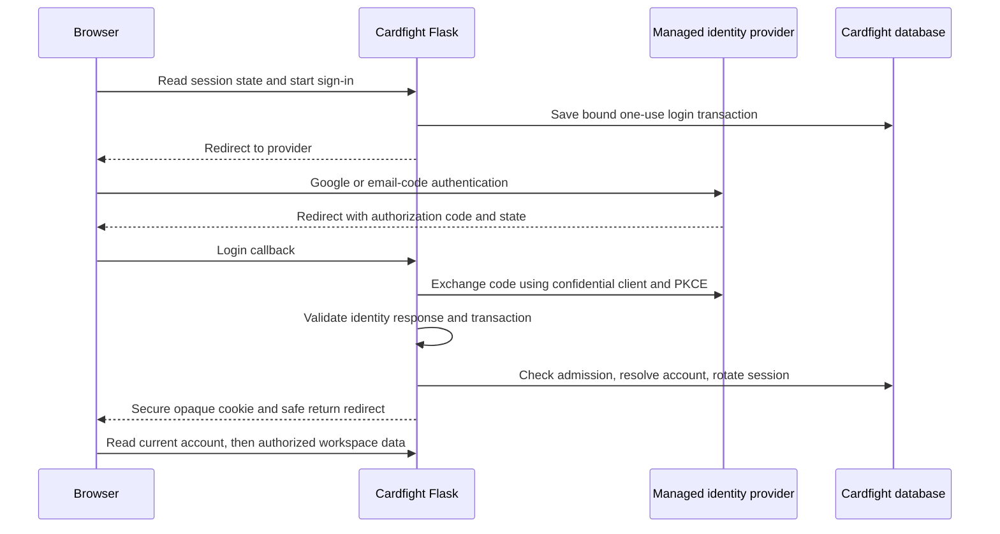

# ADR 0001 Identity and application access

- Status: Accepted for the first implementation slice; provider/staging verification pending
- Date: November 5, 2026
- Owner: Cardfight application
- Selected beta sign-in methods: Google and email
- Work: [Accounts and access #54](https://github.com/Trevasaures/cardfight/issues/54)
- Related: [Data ownership #55](https://github.com/Trevasaures/cardfight/issues/55), [hosted deployment #57](https://github.com/Trevasaures/cardfight/issues/57), [match adapter #58](https://github.com/Trevasaures/cardfight/issues/58)

## Decision

Use a managed OpenID Connect identity provider and keep the browser session in
Flask. The proposed provider is Auth0 Universal Login, integrated with the
maintained Authlib OIDC client. Google and email are the selected beta sign-in
methods. The proposed email flow uses a one-time code presented by the provider.
Cardfight stores application
accounts, invitation/admission state, roles, and revocable server-side sessions.
It does not collect passwords or implement email-code verification.

Serve the hosted React app, authentication routes, and API at the same origin.
Flask acts as a backend for the frontend: it completes the identity exchange and
returns an opaque session cookie. Provider access/refresh/ID tokens never reach
React, browser storage, or the normal Flask signed-cookie session payload.

This starts with an invite-only beta. Authentication and application admission
are distinct from permission to a particular deck or purchase plan. Hosted
player access remains closed until #55's ownership rules and two-account tests
are complete. An administrator account does not automatically own the existing
personal dataset.

Auth0 documents hosted social/passwordless authentication, and Authlib provides
the Flask OIDC integration. Feature availability, production email delivery,
custom-domain configuration, administrator MFA, pricing, and data-region needs
must be checked in the selected tenant before implementing that external setup.
This decision does not assume a particular free plan or provision any service.
[Universal Login](https://auth0.com/docs/authenticate/login/auth0-universal-login),
[email OTP](https://auth0.com/docs/authenticate/passwordless/authentication-methods/email-otp),
[Authlib Flask OIDC](https://docs.authlib.org/en/latest/oauth2/client/web/flask.html).

## Why this fits Cardfight

The application is a React client and a Flask API with existing route/service
separation and versioned SQLite migrations. A managed provider removes password
storage, reset-email validation, and authentication-factor handling from this
small project. A same-origin server session keeps application access and logout
under our control while leaving the identity provider replaceable behind OIDC.

Direct social-only login would leave the email/recovery path to implement
separately. A self-hosted provider adds identity-server operations. A browser
token-based SPA is feasible, but it adds a second token lifecycle to the client
without a requirement for it in the first beta. None of those changes improves
the initial deck-building workflow enough to justify their extra scope here.

## Identity and data model

These additions are implemented by revision `0002_identity`. The runtime uses
the `auth_` table prefix; anonymous sessions also hold bounded CSRF/invitation
context, and a database throttle table coordinates limits across workers.

| Entity | Purpose and important constraints |
| --- | --- |
| Account | Random immutable UUID, display name, contact email, admission status, role, authorization version, creation/update timestamps. Roles and status are controlled by Cardfight. |
| ExternalIdentity | Unique exact `(issuer, subject)` mapped to one account UUID, plus provider/connection label and verified contact claims. Authentication identifies the account through this mapping. |
| Invitation | Hashed random bearer value, approved recipient, inviter, expiry, revoked/consumed state, and resulting account ID. The initial proposed validity is seven days. |
| AuthTransaction | Short-lived server-side login state, nonce, PKCE verifier, safe return path, invitation context, browser binding, and consumed/expiry state. Proposed lifetime: ten minutes. |
| AppSession | Hash of a cryptographically random opaque session ID, account ID, CSRF secret, creation/idle/absolute expiry, last authentication time, authorization version, and revocation state. |
| AuthAuditEvent | Minimal login/admission/revocation/admin events, account ID where known, time, result category, and request correlation ID; no tokens, codes, raw cookies, passwords, or invitation URLs. |

Account UUIDs are identifiers, not credentials. Existing integer deck, version,
card, match, and purchase IDs stay unchanged. Email, display name, and avatar are
not account keys. `(issuer, subject)` is the external identity key guaranteed by
OIDC; a changed email must not move records to a new account.
[OIDC claim stability](https://openid.net/specs/openid-connect-core-1_0.html#ClaimStability).

Google and email connections can represent different provider identities even
when their emails match. They must not be merged automatically. An unknown
identity cannot enter an existing Cardfight account based on matching email.
The first beta asks the player to use their original sign-in method; explicit
account linking is deferred until it can require recent proof of both identities.
[Auth0 account linking](https://auth0.com/docs/manage-users/user-accounts/user-account-linking).

## Admission and existing data

1. An operator approves a recipient and issues an expiring invitation. Opening
   its link does not consume it: email scanners and browser prefetch must not
   create an account or use an invitation.
2. The server exchanges the invitation URL for server-held context and redirects
   to a clean URL before authentication. Sensitive link values are redacted from
   logs and referrers; invite pages do not load third-party analytics.
3. The player explicitly continues and authenticates with the provider. A
   validated verified-email claim must satisfy the invitation's recipient policy.
   Normalize only documented email syntax; never infer Gmail alias/dot rules.
4. A transaction checks that the invitation is still unused, unexpired and
   unrevoked, resolves the exact external identity, and creates/binds the account
   and consumes the invitation once. A uniqueness conflict cannot create two
   accounts or grant additional seats. An email match alone is insufficient.
   If an unknown external identity's verified contact collides with an existing
   account, hold the invitation and deny new-account creation with generic
   original-method/recovery guidance. Do not consume the invitation, reveal
   identity details, link accounts, or create a second empty workspace. Contact
   collision is a deny/review signal, never proof of account ownership.
5. An admitted account still waits for the ownership-ready release condition
   before private workspace routes are enabled. Uninvited identities do not
   receive an application session with member privileges.

First-login-wins is forbidden for both administrator status and the existing
personal data. The initial administrator is bound through an explicit operator
bootstrap to an authenticated `(issuer, subject)` selected out of band. It is
not inferred from registration order, email domain, a frontend flag, or an
unverified email. Administrative activation requires configured MFA and recent
authentication; there is no lower-assurance fallback for privileged actions.

The later #55 owner assignment explicitly selects an existing account UUID for
the legacy personal records after backup and rehearsal. It preserves IDs,
relationships, quantities, history, and image bytes. Merely creating a member or
administrator account does not claim those records. Account deletion, ownership
transfer, and merging existing datasets are outside this first slice.

## Sign-in protocol

Use authorization code flow with PKCE S256 and an exact registered callback.
Store state, nonce, verifier, and the sanitized relative return path server-side,
bound to a short-lived HttpOnly browser cookie. Transactions are one-use,
expiring, and isolated per login attempt; concurrent tabs must not overwrite one
another's nonce or verifier. Login initiation is an explicit CSRF-protected POST.
The provider callback uses top-level GET code response mode, compatible with a
SameSite=Lax browser binding cookie.

Authlib performs the protocol exchange and ID-token verification. Configure the
trusted issuer/discovery endpoint on the server; validate signature, allowed
algorithm, exact issuer, audience/authorized party where relevant, expiry,
nonce, and required authentication claims. Do not accept a user-supplied issuer,
redirect URI, identity claim, ID token in an API bearer header, or unvalidated
userinfo as proof of login. Discovery/JWKS fetches are bounded and cached for the
configured provider; an unknown key may trigger one controlled refresh.
[Authlib validation](https://docs.authlib.org/en/latest/oauth2/client/web/flask.html),
[OWASP OAuth guidance](https://cheatsheetseries.owasp.org/cheatsheets/OAuth2_Cheat_Sheet.html).

Return destinations are server-approved application routes. Reject absolute,
protocol-relative, backslash/encoded variants, authentication routes, and external
URLs. Store a canonical safe path before redirecting. Invalid input returns to
the dashboard, never to a client-selected external address. Sensitive invitation
parameters are not carried into the saved return path.

## Browser sessions and request policy

Generate at least 256 random bits for each application session, store only its
hash in the database, and issue `__Host-cardfight_session` with `Secure`,
`HttpOnly`, `SameSite=Lax`, `Path=/`, and no `Domain` in hosted mode. Keep the
CSRF token in browser memory, with its secret bound to the server-side session.
Rotate session identifiers after login, reauthentication, and privilege changes;
invalidate the previous identifier transactionally.

Proposed beta timeouts are a 30-minute idle period and a 12-hour absolute limit,
with no persistent remember-me option initially. Treat these as tunable product
defaults, not protocol requirements. Background polling does not keep a session
alive indefinitely. Distinguish an active long-running match from a dead tab;
the match-service admission/reconnect contract must define its own bounded
renewal and grace policy before multiplayer release.

Every authenticated request resolves current session/account status, role and
authorization version from trusted server state. Revoked invitations, suspension,
and role/session changes take effect on the next authorization check. Missing
session storage or unresolved identity fails closed. Valid unexpired local
sessions do not call the provider on each API request; a provider outage blocks
new login/reauthentication, not otherwise-valid application sessions.

All application mutations require a session-bound CSRF token and an exact trusted
Origin; SameSite is additional protection, not the authorization mechanism. GET
and HEAD on normal application/admin/invitation routes never change records,
consume invitations, or grant access. The one narrow exception is the OIDC GET
callback: it may complete only the prior CSRF-protected POST sign-in/join intent
after validating its browser-bound state, nonce, PKCE exchange and one-use code.
A bare callback URL cannot grant access. An auth landing may allocate only
bounded, short-lived pre-authentication context without accepting an invitation.
Session/account/private JSON and auth-error responses
use `Cache-Control: no-store`. Hosted artwork is not publicly cacheable until
#55 explicitly defines which catalog/artwork content is public. A protected
response must not escape the access policy through a shared cache.
[OWASP session guidance](https://cheatsheetseries.owasp.org/cheatsheets/Session_Management_Cheat_Sheet.html),
[OWASP CSRF guidance](https://cheatsheetseries.owasp.org/cheatsheets/Cross-Site_Request_Forgery_Prevention_Cheat_Sheet.html).

Rate-limit login initiation, callbacks, invitation attempts and recovery-related
requests by suitable server-side keys. Provider email codes have their own expiry
and attempt limits. IPs come only from the explicitly configured trusted proxy
chain; do not trust arbitrary forwarded headers. Return `429` with bounded retry
guidance, and avoid responses that reveal whether a particular email has an
account or invitation.

Sign out is a CSRF-protected POST that revokes the local session and expires its
cookie before attempting provider logout. Local revocation succeeds even if the
provider is unavailable. Explain that Cardfight sign-out does not sign the player
out of Google. An explicit use-another-account path invokes account selection;
it must not silently restore the just-removed application's session.
[OIDC logout](https://openid.net/specs/openid-connect-rpinitiated-1_0.html).

Request only `openid profile email` initially, without offline-access scope or
provider refresh-token storage. Discard exchange tokens after verified identity
resolution unless the selected logout integration needs an ID-token hint; any
retained hint is encrypted server-side with a deployment-managed key and erased
when the session ends. Cardfight's account/session state remains authoritative
for application permissions.

Recovery must not revive old credentials or admission decisions from a database
checkpoint. Keep admission globally closed using deployment state outside that
checkpoint. Invalidate restored sessions, pending login transactions and unused
invitations, rotate the external session/restore generation, and reconcile or
explicitly reapprove every restored membership, suspension and role against
trusted operator records. Checking administrators alone is insufficient: a
fresh provider login must not reactivate a member suspended after the checkpoint.
Reopen hosted admission only after that review. The restore generation/key is
held outside the database checkpoint. This operational
credential reset preserves decks/history/artwork and requires fresh sign-in;
it is separate from the schema migration's saved-value preservation guarantee.

## Application access matrix

| Operation | Anonymous | Admitted member | Administrator |
| --- | --- | --- | --- |
| Sign-in page, health, auth status and controlled callback | Minimal access | Minimal access | Minimal access |
| Accept own valid invitation | After verified identity and explicit confirmation | Own identity only | Same verification rules |
| Private workspace API | Denied | Only after #55, scoped to own records | Same ownership rules unless an explicit administrative operation says otherwise |
| Catalog reads | Beta requires admission until a separate public policy exists | Allowed under #55 catalog policy | Allowed |
| Catalog/artwork writes and maintenance recount | Denied | Denied initially | Explicit permission, fresh authentication where required, CSRF-protected mutation |
| Invitations, suspension, role changes and session revocation | Denied | Own-session logout only | Authorized audited operations with MFA/recent authentication |

Return JSON `401` for missing/expired authentication, `403` for denied admission
or permission, `409` for explicit conflicts, `429` for rate limiting and `503`
for a temporary authentication-service dependency failure. No protected API
returns an HTML login redirect to a fetch caller.

## Interface to ownership and online play

Request code receives one immutable server-resolved account context containing
account UUID, admission state, current role/capabilities, session/authentication
time and authorization version. A client-supplied owner ID is never used to set
that context. Route checks provide authentication/permission; #55's service
queries enforce record ownership, related-record validity and aggregate scope.

The match service consumes Cardfight-issued short-lived admission grants using
the stable account UUID. Its contract must bind issuer, audience, expiry,
one-use grant ID, room/seat intent and permitted operation. It does not consume
Cardfight's cookie, provider refresh token, or generic OIDC ID token, and it does
not read Cardfight's identity tables. The
[match-service ADR](https://github.com/Trevasaures/cardfight-match-service/blob/main/docs/adr/0001-invite-only-match-service.md)
continues to own the live-match side of that contract.

## Rollout boundary

This branch implements the first identity runtime and its additive schema after
design review. The [setup and verification runbook](../authentication-setup.md)
records provider configuration and staging work still required. No provider
tenant or credentials are provisioned, and no legacy owner is assigned.

Implementation introduces explicit local and hosted modes. Existing local use
retains a loopback-only, single-user boundary with no implicit claim of hosted
security. Hosted startup requires complete identity configuration. This slice
supports account admission and a holding screen while the workspace remains
closed behind a code capability until the ownership release; an invalid mode or
missing hosted dependency must not fall back to anonymous local access. A request Host
header or apparent loopback address behind a reverse proxy cannot establish the
deployment mode.

Use a same-origin development proxy for `/api` and auth routes. Any HTTP-only
loopback development cookie exception has a distinct name and an explicit dev
mode; hosted cookie protections cannot be disabled by that setting. Staging and
production have separate provider applications, callback/logout allowlists,
credentials, databases and email configuration. Provider credentials remain in
server-side configuration and never use a `VITE_` variable.

Before inviting another person, pass #54's identity/session tests and #55's
two-account ownership/cache tests together in staging. The delivery plan and
experience contract are in [identity delivery](../identity-delivery-plan.md) and
[sign-in experience](../identity-experience.md).
